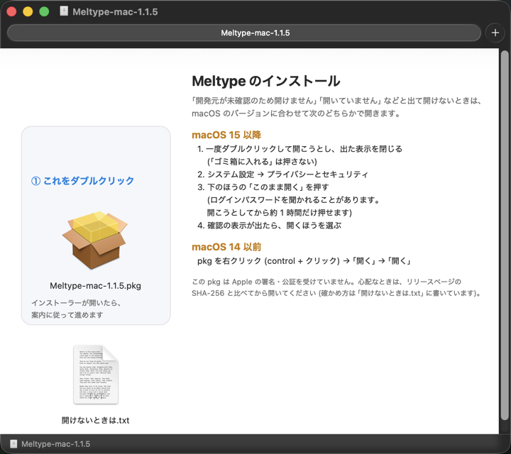

# Meltype for Mac


https://github.com/user-attachments/assets/1b35e133-098b-411b-8ee0-d8805fc6fb69


**雪解けのように、半角/全角の壁を溶かす日本語入力 — Mac 版。**

Mac の標準的な IME の仕組み (Input Method Kit) で動く Meltype です。「英数」「かな」を切り替えなくても、ローマ字のまま日本語と英語を打ち分けられます。
英単語 (`google` `github` …) は英字のまま、英語とも日本語とも読める語は前後の文脈で判定します。メニューバーの入力メニューに、ふつうの日本語入力として表示されます。

このリポジトリは、雪代 / Yukishiro さんの [Meltype](https://github.com/yksr-melt/Meltype) (Windows 版が本家) をもとにした **Mac 版の開発リポジトリ**です。判定・変換の中核 (`src/Meltype.Core`) は本家と共通で、Mac 用の IME (Swift) と、Mac 向けの機能追加を加えています。

> 動かないところがあれば、[Issues](https://github.com/whitewater-png/Meltype-for-Mac/issues) から教えてください。
> 「どのアプリで」「何と打って」「どうなったか」(できればスクリーンショット) があると助かります。

> 更新は個人の気ままな対応です。ご意見・不具合・ご要望などは、ご連絡いただければ幸いです。

## できること

### 日本語と英語の自動判定
- 半角/全角を切り替えずに、ローマ字のまま日本語と英語を混ぜて打てます (`kyouhagoogledekensaku` → 今日はgoogleで検索)
- **ライブ変換 (既定 ON)**: 4 文字以上の日本語は、Space を押さなくても打ったそばから漢字で表示します。英単語と判定した部分は英字のまま、日本語の部分だけが漢字になります。3 文字以下の語はかなのまま表示するので、Space で変換してください
- 英文 (`I want to go to the park`) もそのまま打てます
- **パス・オプション・変数は崩さない**: 行の頭・空白のあとで打った `./src/main.ts`・`~/Downloads`・`-la`・`--no-install`・`$HOME` のようなパス・コマンドのオプション・変数は、変換ボックスの中で `。`・`ー`・全角の記号に変えず、英字のまま確定します。拡張子のあとに続けた日本語は日本語になります (`./build.shde` → `./build.shで`)。判定の強さ「手動」とかな入力では働きません
- 絵文字・顔文字の変換 (えがお → 😊)、よくある書き間違いの指摘
- Zenzai (ニューラル変換) を設定で ON にできます。文脈に合う漢字が先頭に来やすくなります (実験的、既定 OFF、モデルを 1 回ダウンロード)
- 打った内容をネットワークに送りません。判定・変換はすべて Mac の中で行います (通信するのは新しい版の確認と、Zenzai を ON にしたときのモデルの取得だけ。下の「プライバシー」を参照)

### Mac 版で実装した機能
- **F6〜F10 の表示切り替え**: F6 ひらがな / F7 カタカナ / **F8 半角カナ** / F9 全角英数 / F10 半角英数。変換中でも使えます
- **Ctrl キーの代替**: F キーが macOS のショートカットに取られる場合に備えて、変換ボックスが出ているときは Ctrl キーでも同じ操作ができます (Apple 日本語入力と同じ割り当て)
  | Ctrl + | 動作 |
  | --- | --- |
  | J | ひらがな |
  | K | カタカナ |
  | ; | 半角カナ |
  | L | 全角英数 |
  | ' (JIS は :) | 半角英数 |
- **US 配列**: ローマ字入力と英語・日本語の自動判定は、JIS と同じように使えます。日本語の入力中の `\` は、全角の ￥ にならず半角のままです。かな入力 (JIS) は JIS キーボード専用です (US 配列の実機での確認は、まだ十分ではありません)
- **「英数 (Meltype for Mac)」入力モード**: 入力メニューに「Meltype for Mac」と「英数 (Meltype for Mac)」の 2 つが並びます。JIS キーボードの「英数」「かな」キー、**Caps Lock**、入力メニューで切り替えられます (US 配列は Caps Lock か入力メニュー)
- **予測変換**: ひらがなを 2 文字以上打つと、候補ウィンドウに予測が出ます。**Tab** で予測に入り、↓↑ で選び、**Enter** で確定します。英語と判定した語には出ません。出どころは、ユーザー辞書・azooKey の予測・変換履歴の 3 つです。よく使う語・最近使った語ほど上に出ます (回数が 30 日で半分に減る重み付け) 変換エンジンの予測は、読みが 40 文字を超えると出しません (ユーザー辞書・変換履歴の予測は長くても出ます)。
- **候補の数字キー選択**: 変換中に **1〜9** で候補を選んで確定、**PageUp / PageDown** で 9 個ずつ移動
- **学習**: 選び直した候補を覚えます。azooKey の学習も有効で、使うほど文節の区切りと候補の順が良くなります (`~/Library/Application Support/Meltype/` に保存)
- **ユーザー辞書への登録**: 入力メニューの「選択中の文字をユーザー辞書に登録…」で、選択した文字と読みを登録できます
- **専門用語集(サンプル)**: 同梱の専門用語集 (土木・AI・IT・医療・ネットスラング・映像) はサンプルです。自分の用途に合わせて育てていくための出発点としてお使いください (既定はすべて OFF)。ネット上の公開情報をメンテナーが収集してリスト化したもので、内容の正確さは保証せず、利用によって生じた損害について責任を負いません ([THIRD-PARTY-NOTICES.md](THIRD-PARTY-NOTICES.md))
- **辞書の管理 (「Meltype 辞書」)**: 入力メニューの「設定・辞書…」で、ユーザー辞書の一覧・検索・登録・編集・削除 (⌘Z で元に戻せる)・取り込み・書き出しと、専門用語集の分野の ON/OFF・語ごとの除外・直してユーザー辞書へ登録ができる画面が開きます。変更は動いている Meltype にすぐ反映されます ([mac/README.md](mac/README.md) の「辞書の管理」)
- **辞書への登録提案**: 同じ語を選び直して 3 回確定すると、入力メニューに「『語』を辞書に登録」が出ます。「登録しない」を選んだ語は二度と提案しません。提案の履歴は入力メニューから消去できます
- **確定した直後の F10 / F6**: 確定した直後 (約 3 秒以内、次の語を打つ前) なら、F10 で英字に直し、F6 でかなに戻した変換ボックスを開きます (Enter で確定、Esc 1 回で元に戻ります)。直すのは語ではなく確定した 1 回分まるごとで、次からその語は直した方になります (よく使う日本語を英字にするときは 2 回)。入力欄の中身を返さないアプリでは効かず、キーはアプリに渡ります。設定で Ctrl+' (英字) / Ctrl+J (かな) にも割り当てられます (既定 OFF)
- **判定を調べる**: 「設定・辞書…」の「判定を調べる」タブ (⌘4) で、打ったローマ字が今の設定・学習でどう英語 / 日本語に分かれるかと、条件 (学習した語・前後の文字・判定の強さ) を 1 つだけ変えると結果が変わるかを見られます。学習した語が原因なら、その場で消せます ([mac/README.md](mac/README.md) の「判定を調べる」)
- **確定後の再変換**: 確定した文字を選択して **Shift + Space** を押すと、読みに戻して変換し直します (Esc を 2 回で元の文字に戻ります)。ローマ字のまま入ってしまった文 (`asita no meeting de review shimasu`) を選んだときは、読みに戻さず、Meltype の判定で日本語の所だけを日本語にした文 (明日の meeting で review します) を候補に出します (Enter で置き換え、Esc 1 回で選んだままに戻ります)。日本語入力 (「あ」) にしてから押してください
- **Tab で変換 (設定、既定 OFF)**: 「設定・辞書…」→「設定」タブの「Tab で変換」を ON にすると、入力中の Tab で Space と同じく変換を始め、その変換の中では Tab で次の候補、Shift+Tab で前の候補になります。予測変換などの候補が出ているときは今までどおりそちらに使い、英語で終わっているときは確定して Tab をアプリに渡します。OFF のときは、今までどおり確定して Tab をアプリに渡します (フォームで日本語を打って Tab で次の欄へ移る操作を変えないため)
- **ATOK スタイルのキー操作 (設定、既定 OFF)**: ON にすると、変換中の ← → で文節を縮める / 伸ばす、↓ で選んでいる文節までを確定 (部分確定)、Shift+← → で前 / うしろの文節へ、Ctrl+← → で先頭 / 最後の文節へ移ります。変換前の入力中は、Shift+↓ で先頭の 1 音だけを確定します (1 音確定。英字は 1 文字ずつ)
- **候補の意味**: 変換中に同じ候補で約 1.5 秒止まると、候補ウィンドウの横に意味を出します (既定 ON。「設定」タブの「候補の意味を表示」で OFF にできます)。意味は同梱のウィクショナリー・JMdict の英訳で、どちらにも無い英字の語 (`meeting` など) は Mac の辞書を引いて 1 文を出します (Mac の中で引きます。確認した範囲では通信しません。合う項目が無ければ何も出しません)
- **句読点・記号の設定**: 「、。」「，．」「，。」の選択と、`! ? ~` などを全角にするかどうか、丸括弧 `( )` と中括弧 `{ }` を全角・半角のどちらにするかを設定できます (`[ ]` は日本語と判定したときは「」、英語と判定したときは `[ ]` の自動判定のままです)
- **アプリ別の挙動**: Terminal・iTerm2・Ghostty・WezTerm・VS Code・Cursor・Zed・Xcode・JetBrains 系などのコード向けアプリでは、英数 (直接入力) から始まります。その入力欄でキーを打ったあとに英数・かなキー・入力メニュー・Caps Lock でモードを変えると、コード向けアプリごとに覚えて、次にそのアプリに戻ったときもそのモードで始まります (Meltype が動いている間だけ。保存はしません)。アプリ別設定で OFF にしたアプリでは、Meltype はキーを一切処理しません
- **コマンド名は英字で確定**: コード向けアプリで日本語のまま、行の頭・空白のあとに `cd` `ls` `make` `sudo` `open` などのコマンド名だけを打つと、打っている間はかなに見えますが、Space・Enter・Tab で英字のまま確定します (Space は空白つき)。ターミナルを日本語モードのままでもコマンドを打てます。一般のアプリでは今までどおりです

## インストール

### Homebrew
```
brew install --cask whitewater-png/meltype-for-mac/meltype-for-mac
```
- **インストール後は、いったんログアウトしてログインし直してください** (Homebrew の処理の中では入力ソースの登録を済ませられません。ログアウトしないと、入力メニューに Meltype for Mac が出ても入力できないことがあります)
- `~/Library/Input Methods/Meltype.app` が既にある (zip や dmg で入れた) ときは、Homebrew は入れません。先に「Uninstall Meltype.command」などで外してください
- 更新は `brew upgrade --cask meltype-for-mac`、外すときは `brew uninstall --cask meltype-for-mac` です
- これは本家 Meltype (Windows 版・本家の Mac 版) とは別の、この Mac 版リポジトリの配布です。tap は [whitewater-png/homebrew-meltype-for-mac](https://github.com/whitewater-png/homebrew-meltype-for-mac) です

### 配布版 (dmg・ダブルクリックのインストーラー)
1. [Releases](https://github.com/whitewater-png/Meltype-for-Mac/releases) から `Meltype-mac-<version>.dmg` をダウンロードして、ダブルクリックで開く (開いたウインドウの背景に、開き方の図が出ます)
2. 中の `Meltype-mac-<version>.pkg` をダブルクリックする
   - 「開発元が未確認のため開けません」「開いていません」などと出たら、表示を閉じてから (「ゴミ箱に入れる」は押さない) 次のようにします
   - macOS 15 以降: システム設定 → プライバシーとセキュリティ → 下のほうの「このまま開く」を押す (ログインパスワードを聞かれることがあります。「このまま開く」は、開こうとしてから約 1 時間だけ押せます。確認の表示が出たら、開くほうを選びます)
   - macOS 14 以前: pkg を右クリック (control + クリック) →「開く」→「開く」
   - 心配なときは、リリースページの SHA-256 と `shasum -a 256 <ダウンロードしたファイル>` の結果を比べてから開いてください
3. インストーラーの案内に従って進める (「このユーザーのみ」に入るので、管理者パスワードは不要です)
4. メニューバーの入力メニューで Meltype for Mac を選ぶ。出ていないときは、下の「配布版 (zip)」の 3. と同じようにします



同じ案内は、dmg の中の「開けないときは.txt」にも書いてあります。**dmg は動作確認中です** (うまくいかないときは zip を使うか、Issue で教えてください)。

### 配布版 (zip)
1. [Releases](https://github.com/whitewater-png/Meltype-for-Mac/releases) から `Meltype-mac-<version>.zip` をダウンロードして展開する
2. 「Install Meltype.command」をダブルクリックする
   - 「開発元が未確認のため開けません」と出たら、右クリック (control + クリック) →「開く」→「開く」
   - macOS 15 以降は、一度ダブルクリックしてから システム設定 → プライバシーとセキュリティ → 下のほうの「このまま開く」
3. メニューバーの入力メニューで Meltype for Mac を選ぶ。出ていないときは、いったんログアウトしてログインし直す (それでも出ないときは、システム設定 → キーボード → 入力ソース →「編集…」→「+」→ 日本語 → Meltype for Mac を追加)

必要なもの: **macOS 13.3 以降、Apple シリコン (M1 以降)** の Mac (配布している zip は Apple シリコン用です。ソースからのビルドは Intel の Mac でも作れます。下の「ソースからビルドする」)。署名は ad-hoc で、Apple の公証は受けていません。

新しい版に入れ替えるときも、同じ手順です。`~/Library/Input Methods/Meltype.app` を自分で消して入れ直さないでください (ログアウトするまで入力メニューに出なくなります)。

**1.0.4〜1.0.9 をお使いの場合**は、入力メニューの更新が失敗するので、[Releases](https://github.com/whitewater-png/Meltype-for-Mac/releases) から zip をダウンロードして展開し、「Install Meltype.command」で手で入れ替えてください (設定と辞書はそのまま残ります)。1.0.10 以降は、入力メニューの更新が使えます。

### アンインストール
**いちばん簡単な方法**: 配布の zip を展開したフォルダーにある **`Uninstall Meltype.command`** をダブルクリックします
(「開発元が未確認」と出たら、右クリック →「開く」→「開く」。macOS 15 以降は、一度ダブルクリックしてから システム設定 → プライバシーとセキュリティ → 下のほうの「このまま開く」)。画面の案内に従って進めます。

1. 「アンインストールします。よろしいですか?」と聞かれるので、`y` を入力して Enter を押します。
2. 入力ソース (「Meltype for Mac」「英数 (Meltype for Mac)」) を外し、動いている Meltype を止めて、`~/Library/Input Methods/Meltype.app` を削除します。
3. 「設定・学習データ・ユーザー辞書・自作の専門用語集も削除しますか?」と聞かれます。
   - **`N` (既定)**: 残します。あとで入れ直すと、そのまま使えます。
   - **`y`**: 削除します。削除の前に、ユーザー辞書 (`userdict.txt`)・自作の専門用語集 (`terms/`)・専門用語集の除外 (`terms-excluded.txt`) を、デスクトップの `Meltype-backup-<日時>` フォルダーにバックアップします。
4. 終わったら、**いったんログアウトしてログインし直してください**。入力メニューから Meltype for Mac が完全に消えます。

ターミナルから実行することもできます (zip を展開したフォルダー、またはこのリポジトリの `mac/` で):

```bash
bash uninstall.sh                          # 対話式 (上と同じ)
bash uninstall.sh --yes                    # 確認なしでアプリを削除 (データを消すかは聞く。端末でなければ残す)
bash uninstall.sh --yes --keep-data        # 確認なしでアプリを削除し、データは聞かずに残す
bash uninstall.sh --yes --remove-data      # 設定・学習データ・ユーザー辞書・自作の専門用語集も削除 (辞書と専門用語集はバックアップする)
```

消すもの・残すもの:

| 場所 | 中身 | 既定 |
| --- | --- | --- |
| `~/Library/Input Methods/Meltype.app` | Meltype 本体 (中の辞書の管理画面「Meltype 辞書」を含む) | 削除する |
| `~/Library/Application Support/Meltype/` | 設定・学習データ・ユーザー辞書 | 残す (聞かれたとき `y` で削除) |

**入力ソースを自動で外せなかったとき** (古い版を入れていた場合など) は、画面に案内が出ます。システム設定 → キーボード → 入力ソース →「編集…」で、Meltype for Mac を選んで「−」で外してください。

**手で消す場合** (スクリプトが使えないとき):

1. システム設定 → キーボード → 入力ソース →「編集…」で Meltype for Mac を外す
2. ターミナルで `rm -rf ~/Library/Input\ Methods/Meltype.app`
3. (任意) 設定・学習データも消すなら `rm -rf ~/Library/Application\ Support/Meltype`
4. ログアウトしてログインし直す

注意: 入力ソースを外す前にアプリだけを消すと、入力メニューに Meltype for Mac が残ることがあります (ログアウトして入り直すと消えます)。学習データだけを消したいときは、アンインストールせずに、入力メニューの「学習データをすべて消去…」を使えます (ユーザー辞書と設定は残ります)。英字のまま / かなにすると覚えた語は、「Meltype 辞書」の「学習した語」タブで 1 語ずつ確かめて削除できます。

### ソースからビルドする
必要なもの: Xcode またはコマンドラインツール (`xcode-select --install`)、.NET 10 SDK。ビルドした機械の CPU 用に作られるので、Intel の Mac でビルドすれば Intel 用になります (配布している zip は Apple シリコン用だけです)。

```bash
cd mac
./build.sh
```

詳しい手順とトラブルシューティングは [mac/README.md](mac/README.md) を見てください。

## 使い始める

メモ帳やブラウザーの入力欄で、IME を気にせずそのままローマ字で打ってください。

- 英単語は英字のまま、日本語はかなで、下線付きの変換ボックスに出ます。4 文字以上の日本語は、ライブ変換で Space を押さなくても漢字で表示されます (既定 ON。入力メニューの「設定・辞書…」→「設定」タブで OFF にできます)。それより短い語は Space で変換してください
- **Space** で漢字に変換 (候補の一覧が出ます)、**Enter** で確定、← → で文節を選択、**Esc** で取り消し
- 変換したあとに続けて文字を打つと、ふつうは今の候補で確定して新しい入力になります。入力メニューの「設定・辞書…」→「設定」タブの「変換後も続けて入力できる」を ON にすると (既定は OFF)、確定せず、打った文字を未変換のかなとして続けられます。続けて Space で変換、← → で前の文節の選び直し、Enter で全体を確定、Esc で変換前の読みに戻ります。ON の間は、変換後の予測変換は出ません
- 設定・学習データ・ユーザー辞書は `~/Library/Application Support/Meltype/` にあります (「設定・辞書…」で開く「Meltype 辞書」の「ファイル」メニューの「データフォルダを開く」から開けます)。設定は「設定・辞書…」の「設定」タブで変えられます (アプリ別設定などタブにない項目は `config.json` を直接編集します)

詳しいキー操作・判定の強さは [docs/USAGE.md](docs/USAGE.md) にあります (Windows 版の項目も含みます)。

## 制限 (知っておいてほしいこと)

- 判定が外れた語は、確定した直後なら、そのまま F10 (英字) / F6 (かな) で直せます。直せるのは語ではなく**確定した 1 回分まるごと**です (F10 は日本語の部分があるとき、F6 は英字の部分があるとき。「きょうはSushiです」の F6 は全体を「きょうはすしです」に)。次からその語は直した方になります (よく使う日本語を英字にするときは 2 回)。入力欄の中身を返さないアプリでは効かず、キーはアプリに渡ります。確定した後は、選んで Shift + Space で読みに戻すこともできます。よく使う語はユーザー辞書に登録できます。ターミナル (Terminal.app で確認) では、確定したあとの F10 / F6 がそもそも Meltype に届かないので、Enter の前に F10 で英字にしてください
- コード向けアプリでは、`make` `more` `go` `date` のようにコマンド名と同じつづりの語を、行の頭・空白のあとに単独で打つと、Space・Enter・Tab で英字のまま確定します (VS Code などで Markdown を書くときも同じです)。日本語にしたいときは、確定の前に Shift + Space か F6 を押してください。逆に、日本語で終わった行の次の行 (Terminal.app で `mkdir 資料` のあとの `cd 資料` など) では、コマンド名と分からないことがあります (`cd` の Space で変換が始まり、空白が消えるなど)。そのときは Space の前に F10 で英字にしてください
- 長い文は、漢字の選び分けが外れやすくなります。読みが 50 文字を超えると区切って変換し、区切りをまたいだ前後の文脈は使えないので、短く区切って確定してください
- 人名・名字と、新しい製品名は苦手です。小文字で打った名前 (`thanks, yui`) は日本語になることがあります。ユーザー辞書に登録するか、語の頭を大文字で打ってください (`Yamada san` → `Yamada さん`)。ただし、名前のすぐ後ろに `!` `,` などが付くと、大文字でも日本語になることがあります
- 日本語の文を大文字で始めると (`Kyou wa …`)、最初の語が英字のままになります。日本語の文は小文字で始めてください
- 全角スペースを打つキーはありません。Space は半角スペースで、Shift + Space は再変換などに使っています。必要なときは、コピーして貼り付けてください
- 再変換 (選んで Shift + Space) は、Google ドキュメントとターミナルでは効きません (何も起きないか、スペースが入ります)。アプリごとの一覧は [docs/HOST_COMPAT.md](docs/HOST_COMPAT.md) にあります
- ターミナルの sudo・ssh のパスワード入力は、ターミナルが秘匿入力にしない限り、ふつうの入力として扱われます。パスワードを打つ前に英数キーで英数にしてください。Terminal・iTerm2 の「セキュアキーボード入力」を ON にすると、ON のあいだは Meltype が働かず、そのアプリでは日本語を打てません (コードからの判断で、実機では確かめていません)
- Homebrew で入れた直後は、ログアウトしてログインし直すまで入力できないことがあります
- 動作を確認したのは macOS 26.6.2 だけです。Intel の Mac (ソースからビルドした場合) と macOS 13〜15 は未確認です

詳しくは [docs/KNOWN_LIMITS.md](docs/KNOWN_LIMITS.md) にあります。

## よくある質問

**Mac のライブ変換と何が違う?**
Meltype にもライブ変換があり (既定 ON。入力メニューの「設定・辞書…」→「設定」タブで OFF にできます)、4 文字以上の日本語は Space を押さなくても漢字で表示します。Meltype では「英数」「かな」を切り替えずに日本語と英語を続けて打て、英単語と判定した部分は英字のまま残り、日本語の部分だけが漢字になります。Mac 標準の日本語入力の動きは確かめていないので、ここでは Meltype の動きだけを書いています。

**かな入力で使える?**
実験的な機能として、JIS キーボードのかな入力に対応しています。入力メニューの「設定・辞書…」→「設定」タブの入力方式で切り替えます。実機で確認したのは JIS キーボードだけで、US 配列ではローマ字入力のまま動きます。

**英数/かなキーで明示的に切り替えたい**
入力メニューの「英数 (Meltype for Mac)」にすると、日本語にせず英数 (直接入力) で打てます。JIS キーボードの「英数」「かな」キー、Caps Lock、入力メニューで切り替えられます (US 配列は Caps Lock か入力メニュー)。自動判定のままでも、語の頭を大文字で打った語は英字のままです。

**F9 などのキーが効かない**
macOS が F キーをショートカットに使っています。システム設定 → キーボード → キーボードショートカットで割り当てを外すか、上の Ctrl キーを使ってください。

**「英数 (Meltype for Mac)」が入力メニューに出ない**
いったんログアウトしてログインし直してください。

**英語のつもりがかなになった / かなのつもりが英字になった**
確定した直後 (約 3 秒以内) なら、そのまま F10 (英字) / F6 (かな) で直せます。直す相手は語ではなく、**確定した 1 回分まるごと**です (F10 は日本語の部分があるとき、F6 は英字の部分があるとき)。次からその語は直した方になります (「今日は」「すし」のように日本語としてよく使う語を英字にするときは 2 回)。別の語を打った後・キャレットを動かした後は効きません (キーはアプリに渡ります)。判定が外れた原因は、「設定・辞書…」の「判定を調べる」タブで調べられます。

**動きがおかしい・止まった**
`pkill -x Meltype` で止められます (次にキーを打つと macOS が起動し直します)。ログは `log stream --predicate 'process == "Meltype"' --level debug` で見られます。

## プライバシー

Meltype は打った内容をネットワークに送りません。変換・学習・辞書の登録提案はすべて Mac の中だけで行い、保存するのは `~/Library/Application Support/Meltype/` の設定・学習データ・ユーザー辞書だけです。

**通信するのは、次の 2 種類だけです。** (1) 新しい版の確認、(2) Zenzai を ON にしたときだけの、モデルの取得 (下)。

**(1) 新しい版の確認。** 既定で 1 日 1 回、GitHub の最新 Release の情報 (`https://api.github.com/repos/whitewater-png/Meltype-for-Mac/releases/latest`) を取得して、新しい版があるかを確かめます。
送るのは取得の要求だけで、GitHub には IP アドレスと Meltype の版 (User-Agent) が見えます。打った内容・設定・辞書は送りません。
入力メニューの「更新を確認する」のチェックを外せば止まります (止めている間は、「今すぐ更新を確認する」を押したとき以外は通信しません。設定は `~/Library/Application Support/Meltype/update.json`)。
更新は、利用者が「新しい版があります…」→「更新する」を押したときだけ行います。Release の zip をダウンロードして SHA-256 と zip の中身を確かめ、署名の検査をしてから入れ替えます (自動では入れません)。入れ替えに失敗したら元の Meltype に戻します。`~/Library/Input Methods/Meltype.app` 以外から動いている Meltype には「更新する」は出ません。
電子署名 (作者の署名) は付いていないので、GitHub のアカウントが乗っ取られた場合は防げません (詳しくは [SECURITY.md](SECURITY.md))。

**(2) Zenzai のモデルの取得。** 設定の「Zenzai (ニューラル変換、実験的)」を ON にしたときだけ (既定は OFF)、変換モデル (約 74 MB) を Hugging Face (`huggingface.co` と、その転送先の CDN `*.hf.co`) から 1 回だけ取得します。送るのはダウンロードの要求だけで、打った内容は送りません。ファイルのサイズと SHA-256 はアプリに固定してあり、一致しなければ使わず、設定を OFF に戻します。取得したあと変換に使うときも、通信しません。取得の途中で設定を OFF にすると、ダウンロードを中止して一時ファイルを消します。

**変換のために読む周りの文字。** 変換のとき、他のアプリのカーソル前の文字 (UTF-16 で 20 単位。実装はカーソルの後ろの 20 単位も読みます) を読み、日英判定と、Zenzai が ON のときは Mac 内のモデルへの入力に使います。保存も送信もしません。

学習の提案用の履歴 (`suggest.json`) には、「読み」「語」「回数」だけを保存し、前後の文章は保存しません。

## 仕組み

| 部分 | 中身 |
| --- | --- |
| IME 本体 (`mac/Sources/MeltypeIME`, Swift) | Input Method Kit でキーを受け取り、変換中の文字・候補の一覧・確定を入力欄に反映する |
| 判定の本体 (`src/Meltype.Mac.Native`) | 英語 / 日本語の判定・ローマ字・変換の流れ・学習・辞書を持つ共通の C# の部分 (`src/Meltype.Core`) を、NativeAOT で Mac 用のライブラリにしたもの |
| 漢字変換 | [azooKey](https://github.com/azooKey/AzooKeyKanaKanjiConverter) の変換エンジン (MIT License、辞書付き) |
| 英単語の判定 | macOS のスペルチェッカー (英語) |

## ライセンス

Meltype は **GNU General Public License v3.0** ([LICENSE](LICENSE)) で公開されています。本リポジトリも同じ条件で、改造版もソースを公開する条件で自由に使えます。
GPL v3 の条件で使えない場合は、本家の作者にご相談ください。貢献の方法は [CONTRIBUTING.md](CONTRIBUTING.md) を参照してください。

使っているライブラリのライセンスは [THIRD-PARTY-NOTICES.md](THIRD-PARTY-NOTICES.md) にあります。

```
Meltype
Copyright (C) 2026 雪代 / Yukishiro (@yksr_melt / @yksr-melt)

This program is free software: you can redistribute it and/or modify it under the terms of the
GNU General Public License as published by the Free Software Foundation, either version 3 of the
License, or (at your option) any later version.

This program is distributed in the hope that it will be useful, but WITHOUT ANY WARRANTY; without
even the implied warranty of MERCHANTABILITY or FITNESS FOR A PARTICULAR PURPOSE. See the GNU
General Public License for more details.
```

## リポジトリの構成 (Mac で使うもの / 使わないもの)

このリポジトリは、本家 Meltype (Windows 版・Linux 版を含む) のソースをもとにしているため、Mac では使わないファイルも残っています。**Mac 版を使う・作るときは、`mac/` フォルダーのスクリプトと説明書を使ってください。**
`./build.sh`、`install.sh`、`uninstall.sh`、`make-pkg.sh` などは、すべて `mac/` の中にあります。トップにある `.ps1` や、`docs/` の Windows 向けのコマンドは、Mac では使いません。

| 場所 | 中身 | Mac での扱い |
| --- | --- | --- |
| `mac/` | Mac 版 IME (Swift)、`build.sh`・`install.sh`・`uninstall.sh`・`make-pkg.sh`・`make-zip.sh`、`README.md`、`INSTALL.txt` | **使う** |
| `src/Meltype.Core/` | 英語 / 日本語の判定・変換・学習・辞書 (Windows / Linux と共通) | **使う** (NativeAOT で Mac 用のライブラリになる) |
| `src/Meltype.Mac.Native/` | Core を Mac の Swift から呼ぶための橋渡し | **使う** |
| `src/Meltype.Core.Tests/` | Core のテスト (`dotnet run --project src/Meltype.Core.Tests`) | **使う** |
| `dictionaries/` | 辞書データ (Core に埋め込まれる) | **使う** |
| `tools/` | 辞書データを作るスクリプト (Node) | 辞書を作り直すときだけ |
| `src/Meltype/`、`src/Meltype.Tests/` | Windows 版のアプリとそのテスト | 使わない |
| `Build-Package.ps1`、`Install-Meltype.ps1`、`Uninstall-Meltype.ps1`、`packaging/` | Windows 版のビルドとインストール | 使わない |
| `linux/`、`native/mozc/` | Linux 版 (IBus) と、Windows / Linux 用の Mozc 変換 | 使わない |
| `docs/DEVELOPMENT.md`、`docs/USAGE.md` | 本家 (主に Windows 版) の開発・使い方 | 参考程度 (Mac 版の手順は `mac/README.md`) |
| `docs/IMPROVEMENT_PLAN.md` | Mac 版の実装計画と、実装済みの内容 | 参考 |

## 開発に参加する

Mac 版のビルド・インストール・トラブルシューティングは [mac/README.md](mac/README.md)、実装計画と実装済みの内容は [docs/IMPROVEMENT_PLAN.md](docs/IMPROVEMENT_PLAN.md) を見てください。本家 (主に Windows 版) の開発手順は [docs/DEVELOPMENT.md](docs/DEVELOPMENT.md) にありますが、コマンドは Windows 向けです。
本家 (Windows 版) の情報は <https://github.com/yksr-melt/Meltype> にあります。
